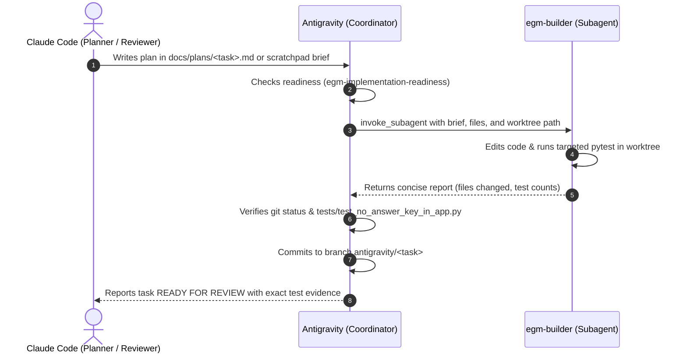

# Antigravity Subagent Architecture & Execution Protocol

This document outlines the subagent delegation setup for Antigravity in the **Analytics Studio** project, ensuring high execution speed, strict adherence to `AGENTS.md`, and significant token savings.

---

## 1. Problem & Architecture Overview

* **Token Optimization Problem:** Running detailed AST inspections, full-file DAX engine reads, and verbose multi-test outputs in the primary conversation consumes tens of thousands of tokens per task, leading to rapid context saturation.
* **Delegation Architecture:** Antigravity serves as the **Lead Coordinator / Reviewer**. When Claude Code provides a plan or brief, Antigravity delegates implementation and local verification to an isolated subagent (`egm-builder`). Only high-signal execution summaries (files changed, diffs, and exact test pass counts) return to the parent context.

---

## 2. Dedicated Subagent: `egm-builder`

### Specification
* **Name:** `egm-builder`
* **Role:** Autonomous Feature Implementer & Runner
* **Tools Enabled:** Full file editing, command execution, MCP tools.
* **Workspace Mode:** Operates strictly within the task-assigned worktree (e.g., `/Users/armaan/wt-<task>` or branch `antigravity/<task>`).

### Strict Directives (Enforcing `AGENTS.md`)
1. **Isolated Workspace:** Must work solely within the assigned git worktree and branch. Never touch `main`.
2. **Compute, Never Look Up:** Compute DAX semantics dynamically from principles. Never reference `tools/parity/`, battery oracle files, or hardcode answer tables.
3. **No Drift / Protected Files:** Never modify existing tests, saved parity answers, `DAX_COMPATIBILITY_CONTRACT.md`, or `PARITY_LEDGER.md`.
4. **Targeted Test Execution:** Run the exact target test suite:
   ```bash
   PYTHONPATH=. pytest <path_to_test> -v
   ```
5. **Concise Report Back:** Return only:
   - Modified files list.
   - Summary of semantic implementation.
   - Exact pass/fail test numbers.
   - Confirmation of zero answer-key lookups.

---

## 3. Installed Review Subagent Personas (`google/elephant-goldfish-model`)

Installed from `google/elephant-goldfish-model` (`/Users/armaan/.gemini/config/plugins/egm`):

* **`egm-implementation-readiness`**: Pragmatic auditor persona. Validates that Claude Code's incoming plan is fully actionable and unambiguous before delegating work to `egm-builder`.
* **`egm-codebase-details`**: Technical quality auditor. Verifies the subagent's changes align with existing DAX evaluation patterns and reuse existing internal libraries.
* **`egm-synthesizer`**: Compiles multi-angle audits and validation into a compact summary for the parent agent.

---

## 4. End-to-End Collaboration Loop



---

## 5. Instructions for Claude Code

When assigning tasks to Antigravity:
1. Provide the target plan path or brief file path.
2. Specify the target worktree and branch name (e.g., `antigravity/<task>`).
3. Specify the targeted test file or expression to verify.
4. Antigravity will handle the subagent dispatch, local testing, branch commit, and report back ready for Claude's parity comparison and gate check.
