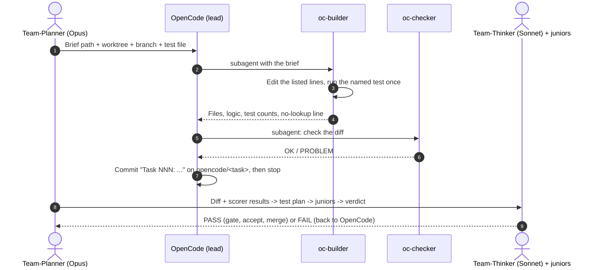

# OpenCode Subagent Architecture & Execution Protocol

This document sets up how OpenCode works on **Analytics Studio**. It mirrors `docs/ANTIGRAVITY_SUBAGENTS.md`: OpenCode follows the same rules (`AGENTS.md`) and works the same way, and only its subagents and its bridge differ.

---

## 1. Team and who codes what

| Name | Who | Job |
|---|---|---|
| **Team-Planner** | Claude Opus (main session) | Plans, writes briefs, picks the coder, verifies, runs the gate, merges. Never writes code. |
| **Team-Thinker** | Claude Sonnet | Head of review and testing: writes the test plan and gives the verdict. Directs the junior testers. |
| **Antigravity** | agy CLI, Gemini (zellij `Power-BI-Tool`) | Coder while it has quota. |
| **OpenCode** | OpenCode v2, DeepSeek flash (zellij `Power-BI-Tool`, pane `terminal_6`) | Coder while it has quota. |
| **Team-Coder / junior** | Claude Haiku | Codes when Antigravity and OpenCode are both out of quota. Also the read-only testers for Team-Thinker. |

### Routing: the Team-Planner decides
- **Antigravity** takes the wide tasks:
  - changes spread over several functions or files in `analytics_studio/measures.py`;
  - new DAX function families;
  - M / Power Query engine work;
  - UI/QML features;
  - anything that needs reading a lot of code.
- **OpenCode** takes the narrow tasks:
  - one function or one call site, with exact lines given in the brief;
  - follow-up fixes from a Team-Thinker FAIL report;
  - adding tests;
  - small refusals and guards;
  - helper functions with a clear spec.
- **When one is out of quota**, the other takes its task type too, if the brief can be made narrow enough.
- **When both are out of quota**, Team-Coder (Haiku) codes, as before.
- **One coder at a time.** Each coder gets its own worktree and branch. The next task is assigned only after the previous one is verified and merged.

Review is the same for every coder:
1. The Team-Planner checks the diff for answer-key lookups.
2. Team-Thinker writes the test plan.
3. Junior testers run it, read-only and in parallel.
4. Team-Thinker gives the verdict.
5. The gate runs, then accept, merge and push.

A FAIL goes back to the same coder with the Team-Thinker report. If the same item fails twice, Team-Thinker fixes it.

---

## 2. OpenCode subagents (project files in `.opencode/agents/`)

### `oc-builder`: implementer
* **File:** `.opencode/agents/oc-builder.md` (`mode: subagent`; it inherits the session model).
* **Role:** codes one brief in its worktree (`/Users/armaan/wt-<task>`, branch `opencode/<task>`).
* **Rules:**
  - compute, never look up;
  - no edits to existing tests, saved answers, `DAX_COMPATIBILITY_CONTRACT.md` or `PARITY_LEDGER.md`;
  - stay inside the lines the brief lists;
  - no exploring and no python experiments;
  - run only the named test file once.
* **Reports:** files changed, the logic in 2–4 lines, exact test counts, and one line confirming there are no answer-key lookups.

### `oc-checker`: read-only review before commit
* **File:** `.opencode/agents/oc-checker.md` (edit denied).
* **Checks:**
  - only the allowed files changed;
  - no answer-key reads;
  - no protected files touched;
  - the new tests cover the brief;
  - `tests/test_no_answer_key_in_app.py` passes.
* **Reply:** OK or PROBLEM with file:line, in 10 lines at most.

The EGM review skills (`/egm-review` etc., installed at `~/.config/opencode/egm`) are optional for OpenCode's own self-review. They are not a replacement for Team-Thinker's review.

---

## 3. Loop

---

## 4. Instructions for the Team-Planner (sending a task to OpenCode)

1. Create the worktree first:
   - `git worktree add /Users/armaan/wt-<task> -b opencode/<task> main`;
   - `mkdir -p tests/Data`;
   - copy in the VAT xlsx (`tests/Data/Vat File -Aug 2026.xlsx`).
2. Write the brief in the scratchpad. It must give:
   - the exact file, function and line numbers;
   - the call site to hook into;
   - the helpers to reuse;
   - the new test file name and a test to copy the pattern from;
   - the commit message start "Task NNN:".

   It must also state the limits: no exploring beyond the listed lines, no python experiments, run only the named test file once, commit and stop.
3. Send it only when OpenCode is idle:
   - `zellij -s Power-BI-Tool action paste -p terminal_6 "Read the brief at <path> and follow it exactly. Use the oc-builder subagent, then oc-checker, then commit and stop."`;
   - then `zellij -s Power-BI-Tool action send-keys -p terminal_6 Enter`.

   Always pass `-p`.
4. Watch cheaply:
   - dump-screen is unreadable on this TUI, so watch the worktree for the commit (`git log main..HEAD`) with a 2-minute background check;
   - read replies with `opencode export <session id>` only when needed.
5. Quota: if OpenCode reports a rate limit or quota error, give the task to Antigravity (if it has quota), or else to Team-Coder (Haiku).
